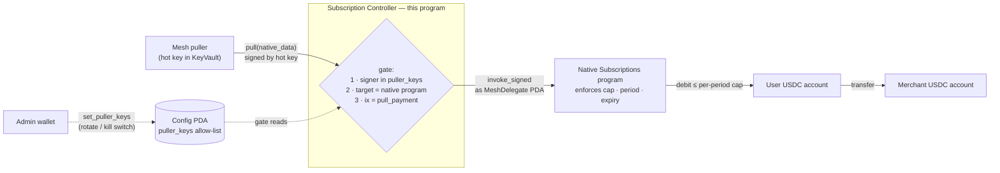

# Mesh Subscription Controller (Anchor program)

## Build & run

Deployment and all operations: **[DEPLOY.md](DEPLOY.md)**.

## What it does

A stateless **signer proxy** that sits between the Mesh puller and Solana's native Subscriptions program.

The controller only authorizes who can trigger a pull; USDC moves directly from the user to the merchant via the native program.

The controller holds no funds. Its only financial rule is a minimum transfer value: a pull below 10,000 token base units ($0.01 in six-decimal USDC) is rejected. This is a minimum-value policy, not a spam control — a rejected pull still costs the sender its transaction fee, so it does not stop a compromised puller key from burning SOL. The native program enforces spending limits, rollover, expiry, and delegatee authorization.

## Why the delegatee is a program-owned PDA

The problem it solves: if the delegatee were a raw keypair, that key would be online, un-rotatable (it's baked into every delegation's address), and un-killable except by each user revoking.  
Making the delegatee a **PDA** with no private key moves the "who can pull" decision off the key and into an on-chain allow-list this program checks:

- **Puller-key rotation** — the operational hot keys that trigger pulls are just entries in `Config.puller_keys`. Add the new key alongside the old, switch the puller over, then drop the old one (`set_puller_keys`). The delegatee points to this PDA and never changes, so no user re-subscribes and no delegation is invalidated.
- **Kill switch** — set `puller_keys` to the **empty list**: no key is authorized, so every `pull` fails and all pulls pause instantly.
Subscriptions and funds are untouched; restore the list to resume.

Both are single admin transactions. And because `MeshDelegate` is derived from the program id alone, it is stable for the life of the program.

> **Accepted tradeoff:** within `pull_payment` the destination and amount are
> caller-chosen, so a compromised puller key can pull up to the per-period cap
> to anywhere — bounded by the kill switch + rotation, not by this program.

## Instructions

| Instruction                      | Signer                   | Effect                                                               |
| -------------------------------- | ------------------------ | -------------------------------------------------------------------- |
| `initialize`                     | upgrade authority (once) | Create `Config`; caller becomes admin.                               |
| `set_puller_keys`                | admin                    | Replace the `puller_keys` allow-list. Empty = kill switch.           |
| `propose_admin` / `accept_admin` | admin, then new admin    | Two-step admin handover (a typo can't brick admin).                  |
| `close_config`                   | admin                    | Close the config, reclaim its rent (teardown).                       |
| `pull(native_data)`              | puller                   | Gate + forward the native `pull_payment`, signing as `MeshDelegate`. |

