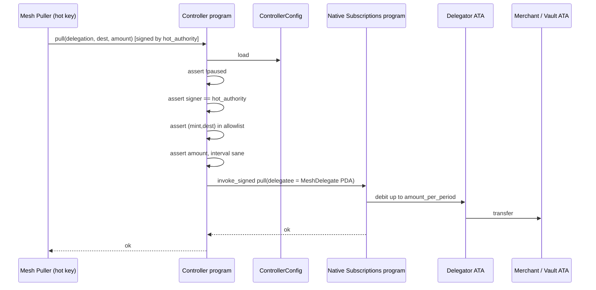
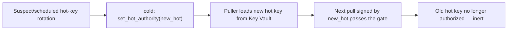
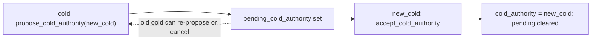

# Mesh-owned Delegatee PDA — TDD

| | |
| --- | --- |
| **Owner** | @Eugen Kleiner |
| **Reviewer(s)** | TBD |
| **Status** | Draft |
| **Jira Epic** | TBD (productionizes the *Milestone 1.1* mitigation in the [Subscriptions MVP TDD](solana-subscriptions-tdd.md)) |

## Summary

Today Mesh pulls recurring-subscription funds by signing each pull with **one shared hot key** that is itself the on-chain `delegatee`. That key is the single largest risk in the feature: if it leaks, an attacker can drain up to each delegation's `amount_per_period` from **every** active delegation and redirect the funds, there is **no kill switch**, and the key **cannot be rotated** (because `delegatee` is a PDA seed baked into every existing delegation).

This TDD replaces the raw hot key with a **program-controlled delegatee PDA**. A small on-chain **Mesh Subscription Controller** program owns a PDA (`MeshDelegate`) that is registered as the `delegatee` on every new recurring delegation. The PDA has **no private key**; the controller program signs each pull *on its behalf* via `invoke_signed` (a CPI into the native Subscriptions program). Because the delegatee is now a stable, deterministic PDA — not a keypair — this design delivers the three properties the raw key can't:

1. **Cold-key kill switch** — a cold-storage authority can instantly pause all pulls program-wide, and (with the optional settlement-vault model) claw back funds pulled within a hold window.
2. **Hot-key rotation** — the operational key that triggers pulls can be rotated at will *without changing the delegatee* and therefore *without invalidating any existing delegation*.
3. **Bounded blast radius** — a leaked hot key can no longer freely redirect funds: destinations are constrained on-chain and the cold key can freeze everything in one transaction.

## Goals

- Replace the raw-hot-key `delegatee` with a program-owned PDA for **all new** subscriptions.
- **Cold key** (root of trust, cold storage / HSM / multisig) that can:
    - pause/unpause all pulls (kill switch — "revert the whole thing" for future charges),
    - rotate the hot (operational) authority,
    - rotate itself (two-step handover),
    - (optional model) claw back / refund funds pulled within a settlement hold window.
- **Hot key** rotation without re-subscribing users or invalidating on-chain delegations.
- On-chain guardrails on the pull path (pause check, destination allowlist, per-pull sanity caps).
- Full backwards compatibility: the puller keeps working for legacy raw-key delegations during migration.

## Non-goals

- Chains other than Solana; SPL tokens other than allow-listed USDC (inherits MVP scope).
- Changing the **subscribe / unsubscribe / auto-pull** control flow, DB schema, or API surface of the MVP beyond what's noted in *Impact on the MVP design*. The delegatee change is transparent to those flows.
- Migrating **existing** raw-key delegations onto the PDA (impossible without re-subscribe — see *Migration*). They are drained via a bounded max-expiry.
- On-chain governance / timelocks beyond the two-step authority handover (future scope).
- Recovering funds already **settled out** of a Mesh-controlled vault to the merchant (clawback is only possible within the hold window — see *Cold-key powers*).

## Background: why the raw key can't rotate

From the MVP threat model:

> Rotation is impossible: `delegatee` is a PDA seed and must sign every pull, so a new key can't pull existing delegations (users must re-subscribe).

The native `RecurringDelegation` PDA is derived from `["delegation", subscriptionAuthority, delegator, delegatee, nonce]` and the program requires `delegatee` to **sign** every pull. If `delegatee` is a raw public key, then:

- the private key must be online to sign every pull (high exposure), and
- changing the key changes the derived delegation address, so a rotated key simply cannot act on delegations created under the old key.

The fix is to make `delegatee` a value that is **stable and does not correspond to any private key**: a PDA. A PDA "signs" only when its owning program calls `invoke_signed` with the PDA's seeds. So the *ability to trigger a pull* moves from "hold this private key" to "be authorized by the controller program," and that authorization can be rotated in program state without ever changing the PDA.

## Architecture

### Components

| Component | What it is | Trust |
| --- | --- | --- |
| **Mesh Subscription Controller** | New on-chain program. Owns `ControllerConfig` and the `MeshDelegate` PDA; exposes `pull`, pause, and authority-rotation instructions. | On-chain, immutable logic (upgrade authority itself held in cold storage / eventually burned). |
| **`ControllerConfig` PDA** | Singleton config account: current authorities, pause flag, allowlist root, version. | Program-owned data. |
| **`MeshDelegate` PDA** | The account registered as `delegatee` on every new delegation. Has no private key; signs pulls via `invoke_signed`. | Derived; controlled solely by the controller program. |
| **Cold authority** | Root-of-trust keypair, kept offline (hardware wallet / HSM / Squads multisig). Rarely signs. | Highest. |
| **Hot authority** | Operational keypair the Mesh puller uses to trigger pulls each period. Online, higher exposure, **rotatable**. | Lowest privileged. |
| **Puller (off-chain)** | Existing `SolanaSubscriptionPullFunction` timer job, re-pointed to call the controller's `pull` instruction instead of signing a native pull directly. | Off-chain service holding the hot key. |

### PDA derivation

```
ControllerConfig = ["config"]                          (program: MeshSubscriptionController)
MeshDelegate     = ["delegate", ControllerConfig]      (the delegatee on every new delegation)
```

`MeshDelegate` is derived from program-owned config, **not** from any authority key. Rotating the hot or cold authority does **not** change `MeshDelegate` — this is the property that makes rotation possible.

### `ControllerConfig` account

| Field | Type | Description |
| --- | --- | --- |
| `discriminator` | u8 | Account-type tag. |
| `version` | u16 | Config schema version (for future migrations). |
| `cold_authority` | Pubkey | Root of trust. Can do everything below. Kept in cold storage. |
| `hot_authority` | Pubkey | Operational key allowed to invoke `pull`. Rotatable by the cold authority. |
| `pending_cold_authority` | Pubkey | Two-step cold-key handover target; `default`/zero when none pending. |
| `pending_hot_authority` | Pubkey | Optional two-step hot-key handover target. |
| `paused` | bool | **Global kill switch.** When true, `pull` fails. |
| `allowlist_mode` | u8 | `0 = off`, `1 = per-mint`, `2 = per-destination` (see *Destination guardrails*). |
| `allowlist_root` | [u8; 32] | Merkle root / config-account pointer describing permitted `(mint, destination)` pairs. |
| `min_pull_interval_s` | u64 | Optional floor on time between pulls per delegation (anti-drain sanity guard). |
| `bump` | u8 | `MeshDelegate` bump for `invoke_signed`. |
| `config_bump` | u8 | `ControllerConfig` bump. |

### Pull flow (new)



The native program still enforces its own invariants (`amount_per_period` cap, period rollover, expiry, `delegatee` must sign). The controller adds a **second gate** in front of it: pause, authorization, and destination/amount guardrails. Both must pass.

### Off-chain trigger authorization (two options)

| Option | How the hot key authorizes a pull | Pros | Cons | Recommendation |
| --- | --- | --- | --- | --- |
| **A. Hot key signs the tx** | Puller signs the `pull` transaction with `hot_authority`; controller checks `signer == hot_authority`. | Simplest; no new crypto; hot key never touches funds directly (only authorizes). | Hot key must be online to sign each tx (fee-payer/authorizer). | **Recommended for v1** — minimal change to the puller. |
| **B. Off-chain Ed25519 authorization + relayer** | Backend signs an authorization message `(delegation, dest, amount, period_index, expiry)`; any relayer submits it; controller verifies via the Ed25519 program. | Signing key can live in an HSM/KMS and never be a Solana fee-payer; gasless relayers possible. | More moving parts; replay guard needed (bind to `period_index`). | Fast-follow if we want the authorizer key fully offline. |

Both options leave the **delegatee unchanged** (`MeshDelegate` PDA), so both are compatible with rotation. Start with A; the config already carries `hot_authority` for A, and B reuses the same field as the message signer.

## Cold-key powers — "revert the whole thing"

"Revert the whole thing" has two distinct meanings on-chain; the cold key covers both to the extent physics allows:

### 1. Stop all future pulls (guaranteed, instant)

`pause()` sets `ControllerConfig.paused = true` in a single cold-key transaction. Every subsequent `pull` fails at the controller gate — across **all** tenants and delegations at once. This is the kill switch: it requires no per-delegation work and no user action. `unpause()` reverses it. This is the strong, always-available "revert" — it guarantees no further funds move.

> Note: the native delegations still *exist* while paused (users' authorizations are untouched); Mesh simply refuses to exercise them. Pausing does not revoke or invalidate delegations, so unpausing resumes cleanly. It also does not block the user's own `revoke`.

### 2. Reverse funds already pulled (bounded — requires the settlement-vault model)

Once tokens land in the **merchant's** own account they are the merchant's property; no on-chain authority Mesh holds can pull them back. True clawback is only possible if pulled funds first land somewhere **Mesh controls**. Two fund-routing models:

| Model | Where a pull deposits | Clawback possible? | Merchant settlement | Complexity |
| --- | --- | --- | --- | --- |
| **Direct** (MVP behavior) | Straight to the merchant ATA | **No** — funds are gone the instant the pull confirms. Only *future* pulls can be stopped (via pause). | Immediate | Low |
| **Settlement vault + hold window** | To a `MeshSettlement` PDA-owned vault ATA; a separate settle step forwards to the merchant after `hold_window` | **Yes** — cold key can `refund(delegation)` any amount still in the vault back to the delegator during the hold window | Delayed by `hold_window` (e.g. 24–72h) | Higher |

**Recommendation:** ship the controller with the **Direct** model first (kill switch + rotation + guardrails already eliminate the top risks), and treat the **settlement vault** as an opt-in follow-up for tenants/regulatory cases that require reversibility. The vault is additive — it changes the `dest` the controller passes into the native pull and adds `settle` / `refund` instructions; it does not change the delegatee or the rotation story.

### Cold-authority instruction set

| Instruction | Signer | Effect |
| --- | --- | --- |
| `initialize_config` | cold | One-time: create `ControllerConfig` + `MeshDelegate`, set both authorities. |
| `pause` / `unpause` | cold | Toggle the global kill switch. |
| `set_hot_authority(new)` | cold | Direct hot-key rotation (or stage `pending_hot_authority` for two-step). |
| `propose_cold_authority(new)` | cold | Stage `pending_cold_authority`. |
| `accept_cold_authority` | **new cold** | New cold key accepts; `cold_authority = pending`, clears pending. (Two-step — prevents bricking on a typo'd key.) |
| `set_allowlist(mode, root)` | cold | Update destination guardrails. |
| `set_limits(min_pull_interval_s, …)` | cold | Update sanity caps. |
| `refund(delegation, amount)` | cold | *(vault model only)* Return vault-held funds to the delegator within the hold window. |
| `set_upgrade_authority` / burn | cold | Governs the program's upgrade authority (kept cold; consider burning after audit). |

## Key rotation

### Hot-key rotation (the headline win)

Because `delegatee = MeshDelegate` PDA is independent of any keypair, rotating the operational key is a **pure config update**:



- **No delegation is invalidated.** All existing `RecurringDelegation` accounts still have `delegatee = MeshDelegate`; they don't know or care which operational key authorized the pull.
- **No user action.** Users never re-subscribe.
- **Zero downtime** if done as: add new key to Key Vault → `set_hot_authority(new)` → puller reads new key. A brief two-key overlap is possible by rotating the Key Vault secret first, then the on-chain authority.
- **Two-step optional** (`pending_hot_authority` + accept) if we want the incoming key to prove control before it becomes active.

**Recommended cadence:** scheduled rotation every 90 days, plus immediate rotation on any suspected exposure. Rotation is cheap (one cold-key tx) precisely because it no longer touches user delegations.

### Cold-key rotation (two-step, bricking-safe)

The cold key is the root of trust, so rotation is deliberately two-step so a mistyped/inaccessible successor can never lock the program:



Until the new cold key calls `accept`, the **old** cold key remains fully in control — so a lost/incorrect successor is recoverable. Recommend the cold authority be a **Squads multisig** (M-of-N hardware signers) so cold-key rotation and pauses require quorum, not a single device.

### Rotation summary

| Key | Rotation mechanism | Invalidates delegations? | Who signs | Typical trigger |
| --- | --- | --- | --- | --- |
| Hot (operational) | `set_hot_authority` config update | **No** | cold | 90-day schedule / suspected leak |
| Cold (root) | `propose` + `accept` (two-step) | No | cold, then new cold | Rare; personnel/device change, compromise |
| Program upgrade authority | multisig / burn | No | cold multisig | Post-audit hardening |

## Destination guardrails (blast-radius bound)

Even with the hot key online, a leak should not let an attacker redirect funds. The controller enforces, on the `pull` path:

- **Destination allowlist** — `(mint, destination)` must be in the configured allowlist (Merkle root in `ControllerConfig`, or the destination must equal the delegation's registered merchant recorded off-chain and passed as a checked account). An attacker with the hot key cannot invent a new payout address.
- **Per-pull amount** is already capped by the native `amount_per_period`; the controller additionally enforces `min_pull_interval_s` to stop rapid re-draining within a period edge.
- **Pause dominates everything** — a compromised hot key is neutralized the moment the cold key pauses.

Net: a leaked hot key can, at worst, pull already-authorized amounts to already-allow-listed merchant destinations — and only until the cold key pauses. It can no longer drain-and-redirect, which is the current design's worst case.

## Impact on the MVP design

The change is intentionally localized. Mapping to the [Subscriptions MVP TDD](solana-subscriptions-tdd.md):

| MVP area | Change |
| --- | --- |
| `SolanaSubscriptionConfig.Delegatee` | Set to the `MeshDelegate` PDA address (per network/env) instead of a raw pubkey. This value is a **PDA seed** on every new delegation. |
| `build-subscribe` / `createDelegation` | Unchanged flow; `delegatee` seed is now the PDA. New delegations derive under the PDA; the `(SourceAddress, SourceTokenMint, Delegatee, Nonce)` uniqueness still holds. |
| Puller Step 1 scan | `getProgramAccounts` delegatee filter switches to the `MeshDelegate` PDA. During migration, run **two** filtered scans (legacy raw key + PDA) and union them. |
| Puller Step 2 submit | Instead of signing a native `pull` with the raw key, build a controller `pull` tx signed by `hot_authority` (Option A). Everything else (simulate → broadcast → wait → `TransferPreview`) is unchanged. |
| DB `Subscriptions.Delegatee` | Stores the PDA for new rows; legacy rows keep the raw key. No schema change required. |
| Unsubscribe ownership check | `delegatee == configured Mesh` becomes `delegatee ∈ { legacy raw key, MeshDelegate PDA }` during migration. |
| Key Vault | `DelegateePrivateKey` is replaced by `HotAuthorityPrivateKey` (rotatable); cold key never in the app's Key Vault — it lives in the multisig/HSM. |

## Migration

Existing raw-key delegations **cannot** be moved onto the PDA: `delegatee` is a seed, so their address is fixed and a different delegatee is a different (nonexistent) account. Strategy:

1. **Deploy controller + config** on devnet, then mainnet; cold key = Squads multisig.
2. **Flip `Delegatee` config** to the `MeshDelegate` PDA. All **new** subscriptions are protected immediately.
3. **Dual-scan** in the puller (legacy raw key ∪ PDA) so old subscriptions keep getting pulled until they expire or are cancelled.
4. **Bounded legacy tail** — the MVP already plans a "reasonable max expiry" (Step 1 mitigation). Legacy raw-key delegations drain out within that bound; no forced user action.
5. **Retire the raw key** once no legacy delegations remain live; drop the legacy scan.

No user re-subscribe is forced; the legacy set simply ages out.

## Security & threat model

| Threat | MVP (raw key) | With controller PDA |
| --- | --- | --- |
| Hot key leaks | Drain up to `amount_per_period` from **all** delegations **and redirect** funds; no way to stop but user revoke. | Bounded: only allow-listed destinations, capped amounts; **cold key pauses everything in one tx**; key rotated with no user impact. |
| Need to stop everything now | Impossible (only users revoke). | `pause()` — one cold-key tx, program-wide. |
| Rotate the operational key | Impossible without re-subscribing every user. | `set_hot_authority` — one cold-key tx, zero user impact. |
| Cold key compromised / lost | N/A (no such key). | Two-step rotation; recommend M-of-N multisig so a single device can't act or brick. |
| Reverse a pull already sent | Impossible. | Direct model: no. Settlement-vault model: yes, within the hold window. |
| Program bug | N/A | Mitigate: minimal instruction surface, audit before mainnet, upgrade authority in cold multisig (or burned post-audit). |

### New residual risks (introduced by this design)

- **Controller program bug** — funds flow through new on-chain logic. Mitigation: keep the program minimal (gate + CPI), external audit, staged rollout, upgrade authority held cold.
- **`invoke_signed` seed handling** — the delegate-PDA seeds/bump must be exactly right and validated; a mistake bricks pulls (fails safe — no fund loss). Covered by tests + simulation.
- **Cold-key operational risk** — multisig quorum unavailability delays a pause. Mitigation: reasonable M-of-N, documented incident playbook, geographically distributed signers.

## Cost per action (delta vs MVP)

| Action | Who pays | Delta |
| --- | --- | --- |
| Pull payment | Mesh | +1 CPI hop + a few account reads → marginally higher CU, still ~$0.0004-range fee. |
| `pause` / `unpause` / rotate | Mesh (cold) | ~$0.0004 fee each; rare. |
| `initialize_config` | Mesh (cold) | One-time rent (~small, single account) + fee. |
| Settlement vault settle/refund *(if adopted)* | Mesh | Extra tx per settlement/refund; rent for vault ATAs. |

Subscribe / revoke costs for the **user** are unchanged (they still create/close native delegations).

## Open decisions

1. **Settlement vault: v1 or fast-follow?** Direct model ships the kill switch + rotation now; vault adds true clawback but delays merchant settlement. *Recommend fast-follow, opt-in per tenant.*
2. **Trigger auth A vs B** — hot key signs (A, simpler) vs off-chain Ed25519 + relayer (B, key can be fully offline in KMS). *Recommend A for v1.*
3. **Cold authority = single hardware key vs Squads multisig.** *Recommend multisig for production.*
4. **Program upgrade authority** — keep upgradable (cold multisig) vs burn after audit. *Recommend keep-cold initially, revisit burning post-audit.*
5. **Allowlist representation** — Merkle root vs on-chain allowlist accounts vs checked-merchant-account-per-pull. Depends on how many distinct destinations we expect.
6. Does the **native Subscriptions program** accept a PDA as `delegatee` signer under `invoke_signed` without additional constraints? *Must be validated on devnet before committing — this is the load-bearing assumption of the whole design.*

## Rollout / task outline (draft)

- [ ] Validate native `pull` accepts a PDA `delegatee` via `invoke_signed` on devnet (open decision #6 — gating spike).
- [ ] Write the Controller program (config + `MeshDelegate`, `pull` gate, pause, rotation instructions).
- [ ] Unit + LiteSVM/Mollusk tests: pause blocks pull; rotation preserves delegations; allowlist enforced; two-step cold handover.
- [ ] External security audit.
- [ ] Devnet deploy; wire puller Option A (dual-scan legacy ∪ PDA).
- [ ] Cold key = Squads multisig; document key-ceremony + incident playbook (pause runbook).
- [ ] Mainnet deploy; flip `Delegatee` config to PDA for new subscriptions.
- [ ] Monitor legacy tail; retire raw key after drain.
- [ ] *(fast-follow)* Settlement vault + `settle`/`refund`; *(optional)* trigger auth Option B.
